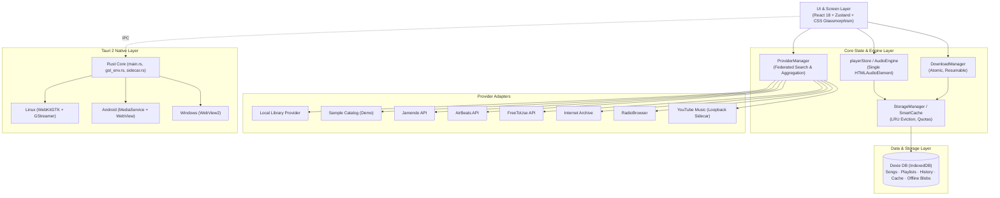

<div align="center">


# KNOX Music

**Your music, your device, your control.**  
*A high-performance, privacy-first, local-first cross-platform music powerhouse.*

[](LICENSE)
[](package.json)
[](package.json)
[](src-tauri)
[](vite.config.ts)
[](tsconfig.json)
[](#supported-platforms)

</div>

---

## Table of Contents

- [Overview](#overview)
- [Core Philosophy](#core-philosophy)
- [Key Features](#key-features)
- [System Architecture](#system-architecture)
- [Provider Catalog & Capabilities](#provider-catalog--capabilities)
- [Supported Platforms](#supported-platforms)
- [Getting Started](#getting-started)
  - [Prerequisites](#prerequisites)
  - [Installation](#installation)
  - [Development Workflow](#development-workflow)
- [Building & Packaging](#building--packaging)
  - [Web / PWA Build](#web--pwa-build)
  - [Linux Desktop (.deb & .AppImage)](#linux-desktop-deb--appimage)
  - [Android (.apk)](#android-apk)
  - [Windows (.exe)](#windows-exe)
- [Linux Desktop Runtime & Codecs](#linux-desktop-runtime--codecs)
- [Testing & Quality Gates](#testing--quality-gates)
- [Directory Structure](#directory-structure)
- [Environment Configuration](#environment-configuration)
- [Troubleshooting & FAQ](#troubleshooting--faq)
- [Contributing](#contributing)
- [License](#license)

---

## Overview

**KNOX Music** is an open-source, local-first music application designed for individuals who demand complete control over their listening experience. Built with React 18, TypeScript, Vite, Dexie (IndexedDB), and Tauri 2, KNOX combines the rich responsiveness of modern web technology with native OS integration across Linux, Android, and Windows.

Whether importing local lossless audio files, streaming from open licensed music repositories, or discovering tracks via integrated sidecar metadata services, KNOX keeps your device at the center. There are **no mandatory cloud accounts**, **no KNOX backend telemetry**, and **zero tracking**.

---

## Core Philosophy

1. **Local-First & Offline-Ready**: Your device is the primary authority. Playlists, listening history, favorites, and metadata exist locally in IndexedDB and function seamlessly without an active internet connection.
2. **Honest Capabilities**: Providers explicitly declare their support for search, streaming, lyrics, and offline storage. Capabilities are not faked: if a source disallows downloading, the UI transparently communicates that status instead of silently failing or ripping streams.
3. **No Private Secrets in Frontend**: All frontend client code relies solely on public client identifiers or local loopback sidecars. Sensitive private keys or credentials are never bundled into the client build.
4. **Resilient State Architecture**: No boolean state confusion. Player and download lifecycles use deterministic finite-state machines (`PlayerState` and `DownloadState`) that survive application restarts and background interruptions.

---

## Key Features

### 🎧 Audio Playback & Full Player
- **Unified Engine**: Singleton `AudioEngine` controlling HTML5 audio with smooth state transitions (`IDLE`, `LOADING`, `PLAYING`, `PAUSED`, `BUFFERING`, `COMPLETED`, `ERROR`).
- **Comprehensive Controls**: Variable playback speed, seek scrubber, shuffle, repeat (all / single track), volume normalization, and configurable sleep timer.
- **Queue Management**: Dynamic playback queue supporting drag-and-drop reordering, track removal, and instant "Save as Playlist".
- **Synchronized Lyrics**: Native `.lrc` file import and real-time synchronized lyrics via the LRCLIB provider.
- **System Media Integration**: Media Session API support with lock screen controls, hardware media keys, and dynamic artwork updates.

### 💾 Offline Storage & Smart Playback Cache
- **Strict Data Partitioning**: 
  - **Offline Library** (`offline` table): Permanent, user-requested tracks that are guaranteed never to be automatically purged.
  - **Temporary Cache** (`cache` / `smartcache` table): Least-recently-used (LRU) playback cache, artwork, and transient search artifacts.
- **Atomic Downloads**: Downloads stream into memory and validate track size (enforcing a 250 MB ceiling) and quota before atomic commit to IndexedDB.
- **Storage Safeguards**: Quota configurations (500 MB to 10 GB, or Unlimited) prompt users with storage management dialogs rather than silently dropping content.

### 📚 Local Library & Scanner
- **Folder & File Import**: Direct directory import via File System Access API or local native paths.
- **Incremental Scanning**: Background batched file scanner that inspects file size and modification timestamps (`mtime`) to skip unchanged audio tracks.
- **Tag Extraction**: In-browser ID3/Vorbis tag parser for title, artist, album, genre, year, track number, and embedded cover art (`jsmediatags` / `music-metadata-browser`).
- **Duplicate Prevention**: Content-aware duplicate detection that flags potential duplicates without destructive automatic deletion.

### 🔍 Federated Multi-Provider Search
- **Debounced Fan-out Search**: Concurrently searches across all enabled providers with isolated per-provider timeouts (default 15s) and resilient partial failure tolerance.
- **Unified Query Parser & Relevance Scorer**: Ranks and deduplicates tracks based on title similarity, artist verification, and bitrates.
- **Live Internet Radio**: Integration with RadioBrowser to stream thousands of global public radio stations categorized by tags and countries.

### 🤖 Autoplay & Recommendation Engine
- **Vibe Classifier**: Analyzes track metadata, genre affinities, and acoustic characteristics.
- **Candidate Scoring**: Auto-queues matching tracks when reaching the end of a playlist or search playout.

### 🎨 Glassmorphism Design System
- **Dark-First Aesthetics**: Dark glass design with CSS backdrop-filters, custom lighting accents, and light/OLED high-contrast modes.
- **Responsive Layouts**: Desktop dual-column sidebar with sticky persistent player bar, transitioning to mobile bottom navigation and compact mini-player sheet.

---

## System Architecture



---

## Provider Catalog & Capabilities

| Provider | Search | Stream | Offline Storage | Lyrics | Description |
|:---|:---:|:---:|:---:|:---:|:---|
| **Local Library** | ✓ | ✓ | ✓ | Local `.lrc` | Imported local audio files (`mp3`, `flac`, `wav`, `m4a`, `ogg`, `aac`). |
| **Sample Catalog** | ✓ | ✓ | ✓ | — | 12 built-in SoundHelix test tracks for development and offline testing. |
| **Jamendo** | ✓ | ✓ | Per-track | — | Licensed independent music API via public `client_id`. Gated by `audiodownload_allowed`. |
| **AirBeats** | ✓ | ✓ (320k) | Per-track | — | Full-length high-fidelity audio streams and direct downloads. |
| **Internet Archive** | ✓ | ✓ | Per-item | — | Non-commercial recordings and live concerts. Streams public audio files. |
| **FreeToUse** | ✓ | ✓ | Non-premium | — | Creator-safe music. (Requires dev proxy due to upstream CORS policy). |
| **RadioBrowser** | ✓ | ✓ | ✗ | — | Live public internet radio stations worldwide. |
| **YouTube Music** | ✓ | ✗ | ✗ | — | **Discovery & metadata only** via bundled loopback sidecar (`services/youtubemusic`). |
| **LRCLIB** | — | — | — | ✓ | Synchronized time-stamped lyrics retrieval. |

> [!NOTE]
> KNOX Music does not rip streams, bypass digital rights management (DRM), or distribute copyrighted media without authorization. Discovery providers remain strictly metadata-only.

---

## Supported Platforms

| Platform | Format / Package | Engine | Status |
|---|---|---|---|
| **Linux Desktop** | `.AppImage`, `.deb`, `.rpm` | WebKitGTK 4.1 + GStreamer | Stable |
| **Android** | `.apk`, `.aab` | Android System WebView + Foreground Service | Stable |
| **Windows** | `.exe` (NSIS) | Microsoft Edge WebView2 | Ready |
| **Web Browser** | PWA (Service Worker) | Native Browser Audio Engine | Stable |

---

## Getting Started

### Prerequisites

- **Node.js**: `v20.x` or higher
- **Package Manager**: `npm` (v10+)
- **Python**: `3.10+` (required for local YouTube Music discovery sidecar)
- **Rust Toolchain**: `1.75+` (only required when compiling desktop/Tauri binaries)
- **Android SDK & NDK**: (only required when building the Android `.apk`)

### Installation

Clone the repository and install dependencies:

```bash
git clone https://github.com/your-username/knox-music.git
cd knox-music
npm install
```

### Development Workflow

#### 1. Web Application Only
Starts the Vite dev server on `http://localhost:5173`:
```bash
npm run dev
```

#### 2. Full Stack (App + Discovery Sidecars)
Launches the frontend together with the Python and Node sidecar services:
```bash
npm run dev:all
```

#### 3. Desktop Application (Tauri Dev)
Runs the desktop window with hot reloading:
```bash
npm run desktop:dev
```

#### 4. Android Development
Launches the app on a connected Android device or emulator:
```bash
npm run android:dev
```

---

## Building & Packaging

### Web / PWA Build
Compiles TypeScript, packages assets, and generates the production PWA in `dist/`:
```bash
npm run build
npm run preview
```

### Linux Desktop (.deb & .AppImage)
Generates the Linux native packages in `src-tauri/target/release/bundle/`:
```bash
npm run desktop:build
```
Produces:
- `knox-music-v1.1.7_amd64.AppImage`
- `knox-music-v1.1.7_amd64.deb`

### Android (.apk)
Generates an optimized standalone Android APK:
```bash
npm run android:apk
# Or for debug build:
npm run android:apk:debug
```

### Windows (.exe)
```bash
cargo tauri build --target x86_64-pc-windows-gnu
```

---

## Linux Desktop Runtime & Codecs

KNOX Music on Linux relies on **WebKitGTK** for rendering and **GStreamer** for audio decoding.

### Why GStreamer is not bundled inside the AppImage
Bundling GStreamer inside AppImages causes severe symbol mismatches with host audio daemons (PulseAudio / PipeWire) and breaks WebKit's hardware discovery. KNOX's Linux binary dynamically links with system GStreamer plugins to ensure audio output routing.

### Required Packages (Debian / Ubuntu / Linux Mint)
```bash
sudo apt update
sudo apt install -y \
  libwebkit2gtk-4.1-0 \
  libgtk-3-0 \
  gstreamer1.0-plugins-base \
  gstreamer1.0-plugins-good \
  gstreamer1.0-plugins-bad \
  gstreamer1.0-plugins-ugly \
  gstreamer1.0-libav \
  gstreamer1.0-alsa \
  gstreamer1.0-pulseaudio
```

### Required Packages (Fedora / RHEL)
```bash
sudo dnf install -y \
  webkit2gtk4.1 \
  gtk3 \
  gstreamer1-plugins-base \
  gstreamer1-plugins-good \
  gstreamer1-plugins-bad-free \
  gstreamer1-plugins-ugly-free \
  gstreamer1-libav \
  gstreamer1-plugins-pulseaudio
```

### Verifying Codecs
```bash
gst-inspect-1.0 appsink | head -5
gst-inspect-1.0 autoaudiosink | head -5
```

---

## Testing & Quality Gates

KNOX has a comprehensive Vitest test suite covering state transitions, atomic downloads, quota enforcement, and provider mappers:

```bash
# Run unit & integration tests
npm test

# Run tests in watch mode
npm run test:watch

# Generate coverage report
npm run test:coverage

# TypeScript type validation
npm run typecheck

# Rust unit tests
npm run test:rust

# Linux packaging gate check
npm run check:appimage
```

---

## Directory Structure

```
MusicProvider/
├── docs/                   # Engineering & architecture specifications
│   ├── architecture.md     # Layer breakdown & state machine specifications
│   ├── providers.md        # Provider contracts, capabilities & API details
│   ├── offline-storage.md  # Atomic storage transactions & quota rules
│   ├── linux-desktop.md    # GStreamer/WebKitGTK configuration guide
│   └── troubleshooting.md  # Error resolution handbook
├── public/                 # Static assets, web app manifest, icons
├── scripts/                # Packaging, dev runners & health verification scripts
├── services/               # Loopback sidecars
│   ├── youtubemusic/       # Python InnerTube discovery sidecar (stdlib-only)
│   ├── youtube/            # Node.js sidecar service
│   └── audioService.js     # Desktop audio background service
├── src/                    # Frontend Application Source
│   ├── api/                # High-level client API facades
│   ├── audio/              # AudioEngine singleton, audio state machine
│   ├── autoplay/           # Recommendation scoring & vibe classifier
│   ├── cache/              # Smart playback cache & LRU eviction engine
│   ├── core/               # Domain types, logger, error handlers, states
│   ├── data/               # Dexie DB schema, repositories & queries
│   ├── desktop/            # Tauri desktop bridge & lifecycle hooks
│   ├── discovery/          # Web & catalog discovery adapters
│   ├── downloads/          # Resumable DownloadManager
│   ├── library/            # Local directory scanner & ID3 tag parser
│   ├── os/                 # MediaSession API, hardware keys & native notifications
│   ├── providers/          # Modular music providers (Jamendo, AirBeats, etc.)
│   ├── screens/            # Top-level route views (Home, Search, Library, Settings, etc.)
│   ├── search/             # Query normalizer, parser, deduplicator & ranker
│   ├── settings/           # Persistent user settings store
│   ├── ui/                 # Glassmorphic UI components, song rows & player
│   └── main.tsx            # React application entry point
├── src-tauri/              # Tauri 2 Desktop & Mobile backend
│   ├── capabilities/       # Security permission ACLs
│   ├── gen/android/        # Android Gradle project & foreground service
│   ├── icons/              # Multi-resolution application icons
│   ├── src/                # Rust main entry, GStreamer repair & IPC commands
│   ├── Cargo.toml          # Rust package dependencies
│   └── tauri.conf.json     # Tauri app configuration & build specifications
├── tests/                  # Integration and unit tests
├── .env.example            # Environment variables blueprint
├── package.json            # Node.js package manifests & build scripts
└── vite.config.ts          # Vite configuration with PWA plugin and dev proxies
```

---

## Environment Configuration

Copy `.env.example` to `.env` to configure optional local overrides:

```bash
cp .env.example .env
```

| Key | Default | Description |
|---|---|---|
| `VITE_JAMENDO_CLIENT_ID` | `ecadb32a` | Public Jamendo API client identifier. |
| `VITE_JAMENDO_API_BASE_URL` | `https://api.jamendo.com/v3.0` | Base endpoint for Jamendo. |
| `VITE_AIRBEATS_API_BASE_URL` | `https://api.airbeats.xyz` | Endpoint for AirBeats streaming. |
| `VITE_INTERNET_ARCHIVE_API_BASE_URL` | `https://archive.org` | Internet Archive audio query endpoint. |
| `VITE_FREETOUSE_API_BASE_URL` | `/api/freetouse` | Vite dev proxy path to bypass CORS restrictions. |
| `VITE_YOUTUBEMUSIC_API_BASE_URL` | `http://127.0.0.1:5000` | Local loopback port for the discovery sidecar. |

> [!WARNING]
> Never commit private tokens or credentials to source control. Frontend builds expose public keys by design.

---

## Troubleshooting & FAQ

### 1. Black screen or audio failure on Linux AppImage
- **Cause**: Missing system GStreamer plugins for WebKitGTK.
- **Fix**: Install `gstreamer1.0-plugins-good` and `gstreamer1.0-plugins-bad`. Run `gst-inspect-1.0 autoaudiosink` to verify installation.

### 2. "YouTube Music unavailable — showing partial results"
- **Cause**: The local Python discovery sidecar is not running.
- **Fix**: In desktop mode, it launches automatically. In browser dev mode, run:
  ```bash
  npm run dev:youtubemusic
  ```

### 3. "Offline storage limit reached"
- **Cause**: Storage quota reached under **Settings → Storage**.
- **Fix**: Navigate to the **Storage** screen to clear the temporary playback cache or raise your allocation limit (up to Unlimited). Saved offline songs are never deleted automatically.

### 4. Search results taking too long
- **Cause**: Slow upstream provider response times.
- **Fix**: Adjust individual provider timeout thresholds under **Settings → Providers**, or toggle off slower providers.

---

## Contributing

Contributions to KNOX Music are welcome! Please adhere to our guidelines:

1. **Fork the repository** and create your branch from `main`.
2. **Adhere to Code Standards**: Ensure clean typing (`npm run typecheck`) and passing tests (`npm test`).
3. **Preserve Privacy & Licensing**: Submissions introducing DRM-ripping, scraping hacks, or private credential leaks will not be accepted.
4. **Submit a Pull Request** with clear reproduction steps or verification details.

See [docs/contributing.md](docs/contributing.md) and [docs/development.md](docs/development.md) for full engineering practices.

---

## License

This project is licensed under the **MIT License** — see the [LICENSE](LICENSE) file for details.
