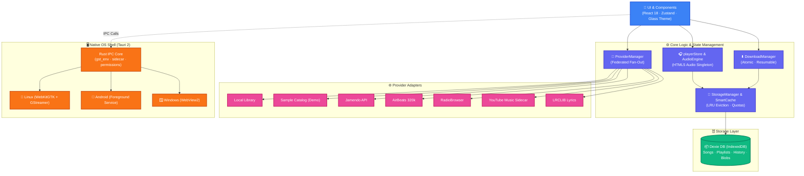

<div align="center">

<br />


# 🎵 KNOX MUSIC

### *Your Music. Your Device. Your Control.*

An ultra-sleek, privacy-first, local-first music powerhouse built for listeners who demand complete ownership of their library.<br />
Zero telemetry. No cloud account required. Atomic offline storage. Native performance.

<br />

[](package.json)
[](LICENSE)
[](#-platform-support--downloads)
[](src-tauri)
[](src/App.tsx)
[](tsconfig.json)

<br />

[✨ Features](#-key-features) •
[⚖️ Why KNOX?](#-why-knox-music) •
[🏗️ Architecture](#-system-architecture) •
[🌐 Provider Matrix](#-federated-providers--capabilities) •
[🚀 Quick Start](#-quick-start) •
[📦 Packaging](#-building--packaging) •
[🐧 Linux Setup](#-linux-desktop-runtime--codecs) •
[📖 Documentation](#-documentation-index)

<br />

</div>

---

## 💡 Why KNOX Music?

Traditional streaming services rent you access to music wrapped inside DRM silos, track your listening habits, and hold your playlists hostage behind monthly subscriptions. **KNOX Music flips the model:** your device is the server.

| Dimension | 🎵 KNOX Music | ☁️ Traditional Streaming (Spotify, Apple, YT) |
|:---|:---|:---|
| **Data Ownership** | **100% Local**: Files & playlists reside on your hardware | Rented access; tracks disappear when licenses expire |
| **User Privacy** | **Zero Telemetry**: No logging, tracking, or fingerprinting | Continuous behavioural tracking, profiling & targeted ads |
| **Account Requirement** | **None**: Launch and immediately listen | Mandatory registration, email, payment card, and login |
| **Offline Capability** | **Atomic Offline Vault**: Real files saved to your disk/DB | Proprietary encrypted blobs that delete if you go offline |
| **Catalog Freedom** | **Federated**: Local tracks + Open Web + Radio + Curated APIs | Walled garden restricted to one catalog contract |
| **Audio Pipeline** | **Lossless local playback** + High-bitrate streams | Lossy transcoding with bitrate caps on non-premium tiers |
| **Price** | **Free & Open Source** forever (MIT) | \$11–\$17 / month subscription fees |

---

## ✨ Key Features

<table>
  <tr>
    <td width="50%" valign="top">
      <h3>🎛️ Studio-Grade Audio Engine</h3>
      <ul>
        <li><b>Single Engine Architecture</b>: Deterministic HTML5 Audio singleton with zero state leaks.</li>
        <li><b>Playback Customization</b>: Variable speed pitch control, precision seek scrubber, shuffle, and repeat (track / queue).</li>
        <li><b>Queue Maestro</b>: Real-time reordering, batch deletions, and instant <i>"Save Queue as Playlist"</i>.</li>
        <li><b>Hardware Integration</b>: MediaSession API with lock-screen controls, notification artwork, and global media keys.</li>
      </ul>
    </td>
    <td width="50%" valign="top">
      <h3>🔒 Dual-Layer Offline Storage</h3>
      <ul>
        <li><b>Strict Partitioning</b>: Permanent <i>Offline Library</i> is isolated from the temporary <i>Smart Playback Cache</i>.</li>
        <li><b>Atomic Transactions</b>: Downloads stream into memory and commit to IndexedDB only after size validation (250 MB ceiling) and quota verification.</li>
        <li><b>Storage Quota Controls</b>: Set limits from 500 MB to 10 GB or Unlimited. Friendly alerts prevent silent eviction of favorite tracks.</li>
      </ul>
    </td>
  </tr>
  <tr>
    <td width="50%" valign="top">
      <h3>📁 Intelligent Local Library</h3>
      <ul>
        <li><b>Folder & File Scanning</b>: Direct directory grants via File System Access API or native paths.</li>
        <li><b>Incremental Scanner</b>: Background batch scanner compares file size and modification timestamps (<code>mtime</code>) to skip unchanged tracks instantly.</li>
        <li><b>Metadata Extraction</b>: Extracts title, artist, album, genre, year, and embedded artwork via <code>jsmediatags</code>.</li>
        <li><b>Duplicate Guard</b>: Content-aware fingerprinting flags duplicates without destructive deletions.</li>
      </ul>
    </td>
    <td width="50%" valign="top">
      <h3>🎙️ Synchronized Lyrics & Radio</h3>
      <ul>
        <li><b>Real-Time Lyrics</b>: Synchronized time-stamped scrolling lyrics powered by the LRCLIB open catalog.</li>
        <li><b>Local <code>.lrc</code> Import</b>: Automatically loads matching local <code>.lrc</code> files alongside your audio files.</li>
        <li><b>Global Radio</b>: 30,000+ live internet radio stations via RadioBrowser categorized by genre, tag, and country.</li>
      </ul>
    </td>
  </tr>
  <tr>
    <td width="50%" valign="top">
      <h3>🔍 Federated Search & Autoplay</h3>
      <ul>
        <li><b>Debounced Multi-Provider Fan-out</b>: Concurrently searches local and online providers with isolated timeouts and partial result recovery.</li>
        <li><b>Smart Query Normalization</b>: Cleans search queries and deduplicates across varied provider formats.</li>
        <li><b>Vibe Recommendation Engine</b>: Auto-queues matching tracks based on acoustic classification when playlists end.</li>
      </ul>
    </td>
    <td width="50%" valign="top">
      <h3>🎨 Premium Glassmorphic UI</h3>
      <ul>
        <li><b>Aesthetic Dark-First Design</b>: Built with custom CSS backdrop filters, ambient light reflections, and responsive breakpoints.</li>
        <li><b>Multi-Theme Support</b>: Deep Dark Glass, Clean Light, and True OLED Black modes.</li>
        <li><b>Adaptive Layouts</b>: Seamless transition between Desktop sidebar + sticky player and Mobile bottom-sheet navigation.</li>
      </ul>
    </td>
  </tr>
</table>

---

## 🏗️ System Architecture

KNOX Music adheres to strict **Layer Separation**: the UI layer never imports or communicates directly with concrete provider implementations.



---

## 🌐 Federated Providers & Capabilities

KNOX strictly respects provider terms: capabilities are gated honestly per-track and per-source without circumventing licensing.

| Provider | Search | Streaming | Offline Download | Lyrics | Bitrate | Operational Notes |
|:---|:---:|:---:|:---:|:---:|:---:|:---|
| 📂 **Local Library** | 🟢 Yes | 🟢 Native | 🟢 Permanent | 🟢 Local `.lrc` | Lossless / Direct | Your personal audio files (`mp3`, `flac`, `m4a`, `wav`, `ogg`, `aac`). |
| 🧪 **Sample Catalog** | 🟢 Yes | 🟢 Direct | 🟢 Permitted | ⚪ None | 192 kbps | 12 SoundHelix demo tracks for testing and offline validation. |
| 🎸 **Jamendo** | 🟢 Yes | 🟢 Direct | 🟡 Per-track | ⚪ None | 128–192 kbps | Licensed independent artists via public `client_id`. Gated by `audiodownload_allowed`. |
| ⚡ **AirBeats** | 🟢 Yes | 🟢 320 kbps | 🟢 Direct | ⚪ None | 320 kbps | Unofficial catalog mirror with full-length high-fidelity streams. |
| 🏛️ **Internet Archive** | 🟢 Yes | 🟢 Direct | 🟡 Per-item | ⚪ None | Varies | Curated public domain, concerts, and historical recordings. |
| 📻 **RadioBrowser** | 🟢 Yes | 🟢 Live | 🔴 Stream Only | ⚪ None | Live Streams | 30,000+ public internet radio stations worldwide. |
| 🔍 **YouTube Music** | 🟢 Yes | 🔴 Disabled | 🔴 Disabled | ⚪ None | *Metadata Only* | Discovery & track lookup via bundled loopback sidecar (`services/youtubemusic`). |
| 📜 **LRCLIB** | ⚪ Query | ⚪ None | ⚪ Cacheable | 🟢 Synced | Text / LRC | Open synchronized lyrics database with precise millisecond timestamps. |

---

## 📱 Platform Support & Downloads

| Platform | Target Package | Architecture | Runtime Engine | Status |
|:---|:---|:---|:---|:---:|
| 🐧 **Linux** | `.AppImage` | `x86_64` | WebKitGTK 4.1 + GStreamer | 🟢 Production |
| 🐧 **Linux** | `.deb` | `amd64` | Native Debian package with auto-dependencies | 🟢 Production |
| 🐧 **Linux** | `.rpm` | `x86_64` | Fedora / RHEL package | 🟢 Production |
| 🤖 **Android** | `.apk` | `arm64-v8a`, `armeabi-v7a`, `x86_64` | Android WebView + Foreground Media Service | 🟢 Production |
| 🪟 **Windows** | `.exe` | `x64` | NSIS installer via Microsoft WebView2 | 🟢 Ready |
| 🌐 **Modern Web** | Progressive Web App | All browsers | Service Worker + IndexedDB | 🟢 Production |

---

## 🚀 Quick Start

### 1. Prerequisites
Ensure you have the following installed on your development machine:
- **Node.js**: `v20.0.0` or higher ([Download](https://nodejs.org/))
- **npm**: `v10.x` or higher
- **Python**: `3.10+` (for the local discovery sidecar)
- **Rust Toolchain**: `1.75+` *(only needed for desktop/Tauri builds)*

### 2. Clone & Install
```bash
# Clone the repository
git clone https://github.com/your-username/knox-music.git
cd knox-music

# Install Node dependencies
npm install
```

### 3. Launch Development Servers

```bash
# Option A: Standard Web App (Vite Dev Server on http://localhost:5173)
npm run dev

# Option B: Full Stack (App + YouTube Music Discovery Sidecar concurrently)
npm run dev:all

# Option C: Desktop App (Tauri dev window with native bindings)
npm run desktop:dev

# Option D: Android App (Live on connected device or emulator)
npm run android:dev
```

---

## 📦 Building & Packaging

<details>
<summary><b>Click to expand packaging instructions</b></summary>
<br />

### Web / PWA Build
```bash
npm run build
npm run preview
```
Outputs static production assets into `dist/` ready for hosting on GitHub Pages, Cloudflare Pages, or Vercel.

### Linux AppImage & Debian Package
```bash
npm run desktop:build
```
Bundles the application into:
- `src-tauri/target/release/bundle/appimage/knox-music_1.1.7_amd64.AppImage`
- `src-tauri/target/release/bundle/deb/knox-music_1.1.7_amd64.deb`

Run the AppImage packaging verification gate:
```bash
npm run check:appimage
```

### Standalone Android APK
```bash
# Standard APK build
npm run android:apk

# Debug APK build (for emulator testing)
npm run android:apk:debug
```
Outputs APKs into `src-tauri/gen/android/app/build/outputs/apk/`.

### Windows Installer (.exe)
```bash
cargo tauri build --target x86_64-pc-windows-gnu
```

</details>

---

## 🐧 Linux Desktop Runtime & Codecs

On Linux, KNOX Music utilizes WebKitGTK and GStreamer for hardware-accelerated playback.

> [!IMPORTANT]
> **Why doesn't the AppImage bundle GStreamer?**  
> Bundling GStreamer inside AppImages causes ABI conflicts with the host system's audio daemons (PulseAudio / PipeWire) and breaks WebKit's native codec discovery. Installing the system packages below guarantees reliable playback and minimal resource usage.

### Debian / Ubuntu / Linux Mint / Pop!_OS
```bash
sudo apt update
sudo apt install -y \
  libwebkit2gtk-4.1-0 \
  libgtk-3-0 \
  gstreamer1.0-plugins-base \
  gstreamer1.0-plugins-good \
  gstreamer1.0-plugins-bad \
  gstreamer1.0-plugins-ugly \
  gstreamer1.0-libav \
  gstreamer1.0-alsa \
  gstreamer1.0-pulseaudio
```

### Fedora / RHEL
```bash
sudo dnf install -y \
  webkit2gtk4.1 \
  gtk3 \
  gstreamer1-plugins-base \
  gstreamer1-plugins-good \
  gstreamer1-plugins-bad-free \
  gstreamer1-plugins-ugly-free \
  gstreamer1-libav \
  gstreamer1-plugins-pulseaudio
```

### Arch Linux / Manjaro
```bash
sudo pacman -S --needed \
  webkit2gtk-4.1 \
  gtk3 \
  gst-plugins-base \
  gst-plugins-good \
  gst-plugins-bad \
  gst-plugins-ugly \
  gst-libav
```

### Verification Command
Verify that WebKitGTK can resolve audio sinks:
```bash
gst-inspect-1.0 appsink | head -n 4
gst-inspect-1.0 autoaudiosink | head -n 4
```

---

## 🧪 Testing & Quality Gates

KNOX maintains high test reliability with unit, integration, and packaging tests:

```bash
# Run Vitest test suite (41+ tests across DB, Audio, Downloads, Providers)
npm test

# Watch mode for active development
npm run test:watch

# Test coverage report
npm run test:coverage

# TypeScript compile validation
npm run typecheck

# Rust unit tests
npm run test:rust
```

---

## 📂 Directory Structure

```
MusicProvider/
├── 📁 docs/                   # Architectural blueprints & engineering docs
│   ├── architecture.md        # State machine definitions & layer segregation
│   ├── providers.md           # Provider capability contracts & rules
│   ├── offline-storage.md     # Atomic storage transactions & quota rules
│   ├── linux-desktop.md       # Linux GStreamer runtime resolution guide
│   └── troubleshooting.md     # Engineering troubleshooting guide
├── 📁 public/                 # Static assets, web app manifest, icons
├── 📁 scripts/                # Health checks, dev orchestrators, packaging gates
├── 📁 services/               # Micro-sidecars
│   ├── youtubemusic/          # Python discovery sidecar (stdlib-only, no API key)
│   ├── youtube/               # Node sidecar service
│   └── audioService.js        # Background audio routing service
├── 📁 src/                    # Frontend Application Source (React 18 + TS)
│   ├── 📁 api/                # High-level client API facades
│   ├── 📁 audio/              # AudioEngine singleton, audio state machine
│   ├── 📁 autoplay/           # Recommendation scoring & vibe classifier
│   ├── 📁 cache/              # Smart playback cache & LRU eviction engine
│   ├── 📁 core/               # Domain types, logger, error handlers, states
│   ├── 📁 data/               # Dexie DB schema, repositories & queries
│   ├── 📁 desktop/            # Tauri desktop bridge & lifecycle hooks
│   ├── 📁 discovery/          # Web & catalog discovery adapters
│   ├── 📁 downloads/          # Resumable DownloadManager
│   ├── 📁 library/            # Local directory scanner & ID3 tag parser
│   ├── 📁 os/                 # MediaSession API, hardware keys & native notifications
│   ├── 📁 providers/          # Modular music providers (Jamendo, AirBeats, etc.)
│   ├── 📁 screens/            # Top-level route views (Home, Search, Library, Settings, etc.)
│   ├── 📁 search/             # Query normalizer, parser, deduplicator & ranker
│   ├── 📁 settings/           # Persistent user settings store
│   ├── 📁 ui/                 # Glassmorphic UI components, song rows & player
│   └── main.tsx               # React application entry point
├── 📁 src-tauri/              # Tauri 2 Desktop & Mobile Backend (Rust)
│   ├── 📁 capabilities/       # Tauri 2 security permission ACLs
│   ├── 📁 gen/android/        # Android Gradle project & foreground service
│   ├── 📁 icons/              # Multi-resolution application icons
│   ├── 📁 src/                # Rust main entry, GStreamer repair & IPC commands
│   ├── Cargo.toml             # Rust package dependencies
│   └── tauri.conf.json        # Tauri app configuration & build specifications
└── 📁 tests/                  # Integration and unit tests
```

---

## ⚙️ Environment Configuration

Copy `.env.example` to `.env` to customize local development variables:

```bash
cp .env.example .env
```

| Environment Variable | Default Value | Purpose |
|:---|:---|:---|
| `VITE_JAMENDO_CLIENT_ID` | `ecadb32a` | Public Jamendo API client identifier. Safe for frontend use. |
| `VITE_JAMENDO_API_BASE_URL` | `https://api.jamendo.com/v3.0` | Base URL for Jamendo queries. |
| `VITE_AIRBEATS_API_BASE_URL` | `https://api.airbeats.xyz` | Endpoint for high-bitrate AirBeats catalog. |
| `VITE_INTERNET_ARCHIVE_API_BASE_URL` | `https://archive.org` | Query base for Internet Archive audio collections. |
| `VITE_FREETOUSE_API_BASE_URL` | `/api/freetouse` | Vite dev proxy path to bypass CORS restrictions. |
| `VITE_YOUTUBEMUSIC_API_BASE_URL` | `http://127.0.0.1:5000` | Loopback address for the local Python discovery sidecar. |

> [!WARNING]
> Never put private tokens or client secrets in `.env`. Frontend code compiles directly into client-visible bundles.

---

## ❓ Frequently Asked Questions

<details>
<summary><b>1. Why does playback fail with a blank/grey window on Linux?</b></summary>
<br />
This occurs when WebKitGTK cannot find a valid GStreamer audio sink on the host machine. Run:

```bash
sudo apt install gstreamer1.0-plugins-good gstreamer1.0-plugins-bad
```
KNOX includes an early startup repair hook (`src-tauri/src/gst_env.rs`) that automatically binds host GStreamer plugin paths.
</details>

<details>
<summary><b>2. Why are YouTube Music tracks labeled "Discovery" and not playable?</b></summary>
<br />
KNOX strictly respects licensing boundaries. The bundled YouTube Music loopback sidecar provides <b>search and metadata discovery only</b>. It is not an audio ripper or stream scraper. To stream music, use our authorized streaming providers (AirBeats, Jamendo, RadioBrowser, or your Local Library).
</details>

<details>
<summary><b>3. How does the Smart Playback Cache work?</b></summary>
<br />
When you stream a song, KNOX opportunistically caches audio chunks into an IndexedDB cache table. If you listen to that track again, it loads instantaneously without network usage. If storage limits are approached, an LRU (Least Recently Used) cleanup prunes oldest cached tracks while <b>never touching your explicitly saved Offline Library</b>.
</details>

---

## 🤝 Contributing

We love contributions! Whether reporting bugs, refining documentation, or proposing new local-first features:

1. **Fork the repo** and create your branch: `git checkout -b feature/my-feature`
2. **Commit your changes**: `git commit -m "feat: add support for flac metadata replaygain"`
3. **Run tests**: Ensure `npm test` and `npm run typecheck` pass.
4. **Push to branch**: `git push origin feature/my-feature`
5. **Open a Pull Request** with clear description and screenshots.

Please read [docs/contributing.md](docs/contributing.md) for full development etiquette.

---

## 📜 License

KNOX Music is distributed under the terms of the **MIT License**.  
See the [LICENSE](LICENSE) file for complete details.

<div align="center">

<br />

**Made with ❤️ for music freedom and local-first software.**

⭐ **Star us on GitHub if you believe in privacy-friendly software!**

</div>
